# Photography Skill · 23 张作品

当ai学会怎么看 和 怎么拍

点击图片查看完整原图。全部为 AI 生成样例，按 P01–P23 编号，与 [逐张分析](references/approved-23-analysis.md) 对应。

<table>
  <tr>
    <td width="33%" valign="top"> <strong>P01 · 上海渡口</strong> 空间参与</td>
    <td width="33%" valign="top"> <strong>P02 · 成都茶馆</strong> 生活节奏</td>
    <td width="33%" valign="top"><a href="references/approved-23/P03-01-window-frame.png">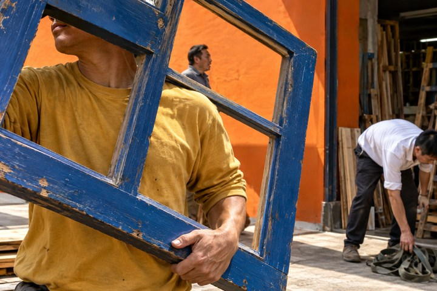</a> <strong>P03 · 搬蓝窗框</strong> 几何显露</td>
  </tr>
  <tr>
    <td width="33%" valign="top"><a href="references/approved-23/P04-04-court-arm.png">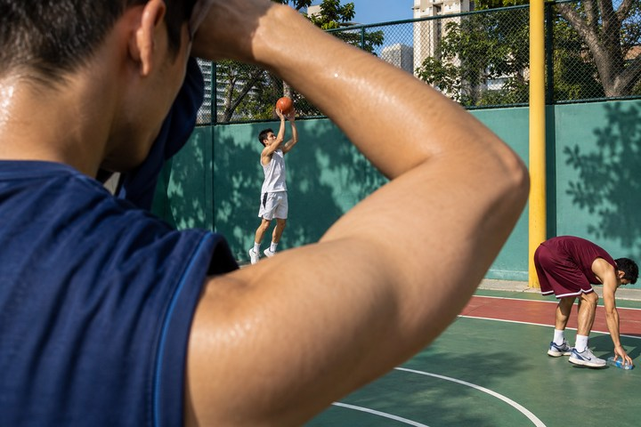</a> <strong>P04 · 球场弯臂</strong> 身体框景</td>
    <td width="33%" valign="top"><a href="references/approved-23/P05-02-barber-mirror.png">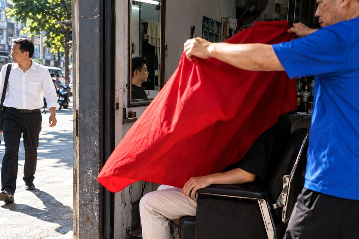</a> <strong>P05 · 理发红布</strong> 遮挡与反射</td>
    <td width="33%" valign="top"> <strong>P06 · 宫墙游泳</strong> 身体临场感</td>
  </tr>
  <tr>
    <td width="33%" valign="top"> <strong>P07 · 辛弃疾写字</strong> 安静张力</td>
    <td width="33%" valign="top"><a href="references/approved-23/P08-01-staircase-chairs.png">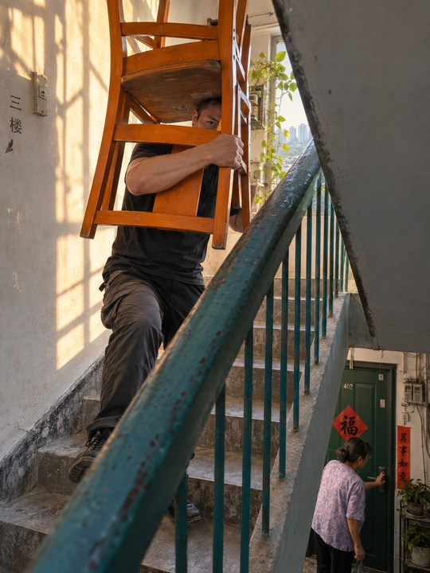</a> <strong>P08 · 搬椅上楼</strong> 几何显露</td>
    <td width="33%" valign="top"> <strong>P09 · 泳池出水</strong> 方向与尺度</td>
  </tr>
  <tr>
    <td width="33%" valign="top"><a href="references/approved-23/P10-02-feet-waiting-for-trousers.png">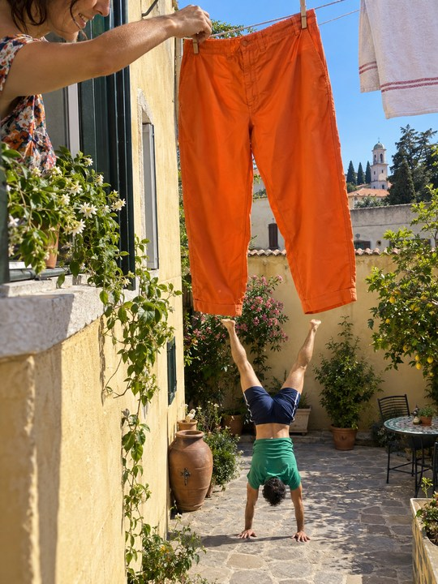</a> <strong>P10 · 空裤腿与倒立</strong> 视觉巧合</td>
    <td width="33%" valign="top"><a href="references/approved-23/P11-04-borrowed-giant-shadow.png">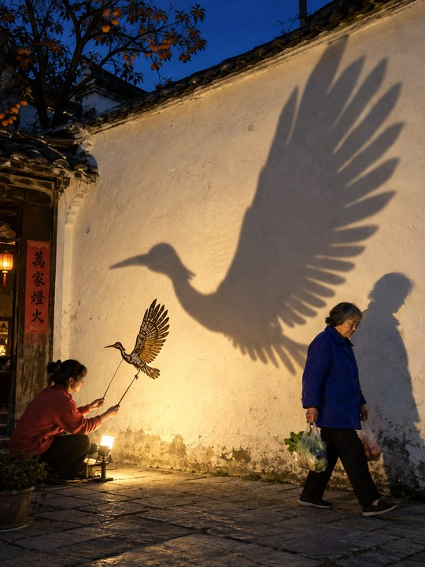</a> <strong>P11 · 巨鸟影子</strong> 影子与反差</td>
    <td width="33%" valign="top"><a href="references/approved-23/P12-03-goldfish-city.png">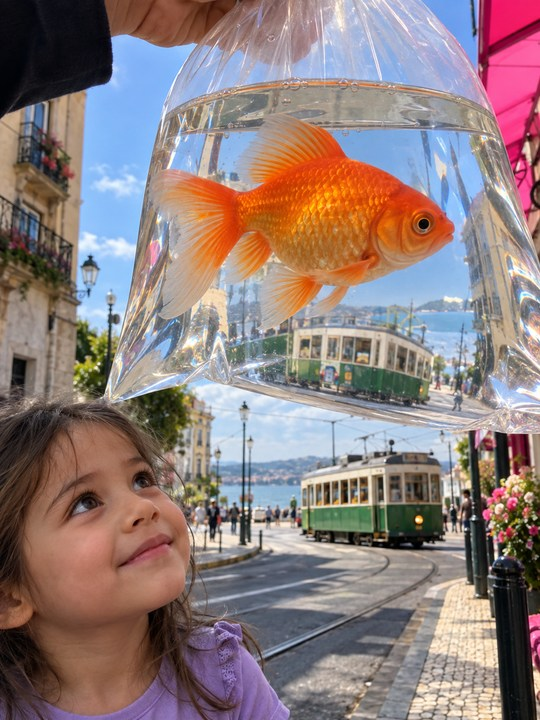</a> <strong>P12 · 金鱼与电车</strong> 近远尺度</td>
  </tr>
  <tr>
    <td width="33%" valign="top"><a href="references/approved-23/P13-06-giant-at-bus-stop.png">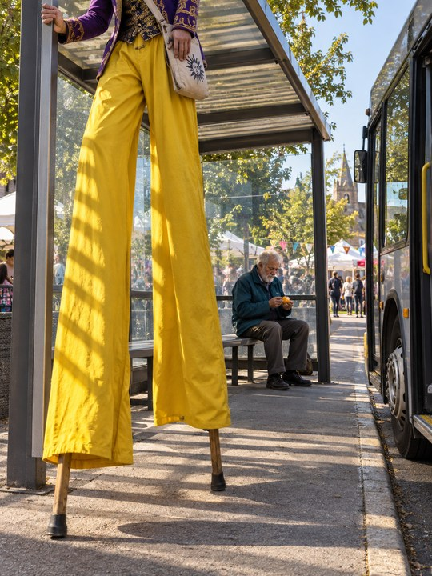</a> <strong>P13 · 高跷等公交</strong> 日常反差</td>
    <td width="33%" valign="top"> <strong>P14 · 宋代茶馆</strong> 动作节奏</td>
    <td width="33%" valign="top"><a href="references/approved-23/P15-01-roman-bakery-28mm.png">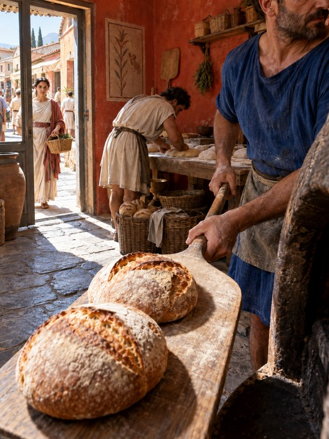</a> <strong>P15 · 古罗马面包房</strong> 物件引导</td>
  </tr>
  <tr>
    <td width="33%" valign="top"><a href="references/approved-23/P16-06-republic-opera-28mm.png">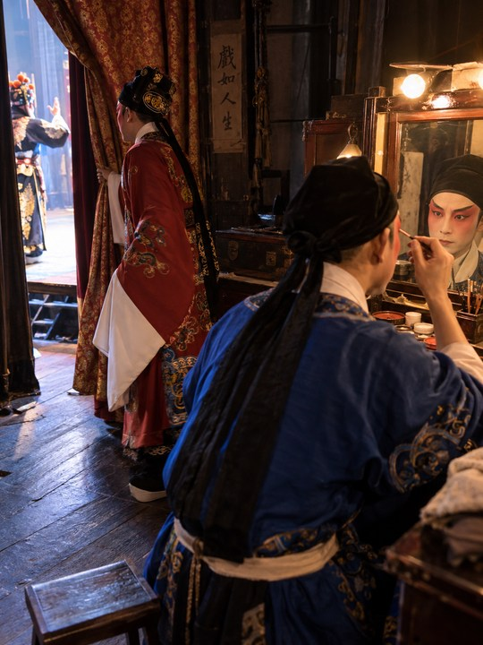</a> <strong>P16 · 民国戏班</strong> 多重空间</td>
    <td width="33%" valign="top"><a href="references/approved-23/P17-07-republic-tram-24mm.png">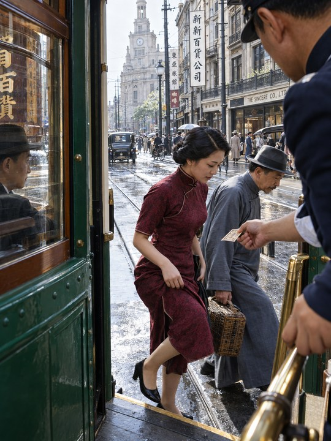</a> <strong>P17 · 民国电车</strong> 门槛时刻</td>
    <td width="33%" valign="top"> <strong>P18 · 土星维修</strong> 巨大世界中的日常动作</td>
  </tr>
  <tr>
    <td width="33%" valign="top"><a href="references/approved-23/P19-02-island-fish-24mm.png">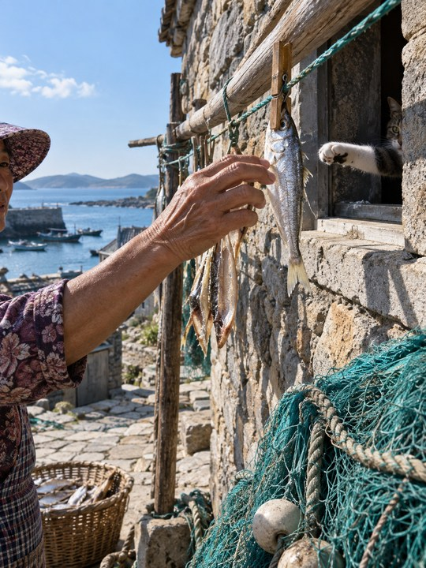</a> <strong>P19 · 海岛晒鱼与猫</strong> 临界交会</td>
    <td width="33%" valign="top"><a href="references/approved-23/P20-03-island-glass-28mm.png">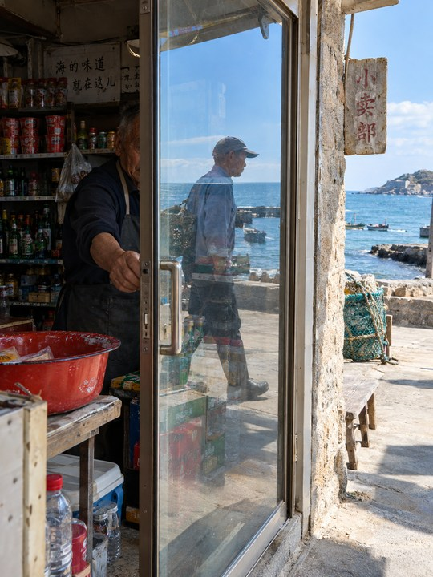</a> <strong>P20 · 海岛玻璃门</strong> 反射与透视</td>
    <td width="33%" valign="top"> <strong>P21 · 海贼王抢肉</strong> 人物互动</td>
  </tr>
  <tr>
    <td width="33%" valign="top"> <strong>P22 · 婺源晒秋</strong> 动作打断</td>
    <td width="33%" valign="top"><a href="references/approved-23/P23-25-harbin-winter-swim-24mm.png">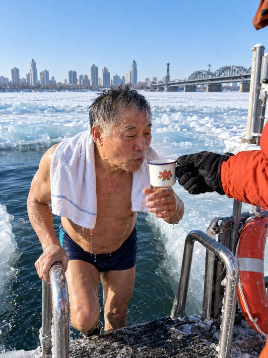</a> <strong>P23 · 哈尔滨冬泳</strong> 温度与关照</td>
  </tr>
</table>

[返回首页](README.md) · [查看统一分析](references/approved-23-analysis.md)
