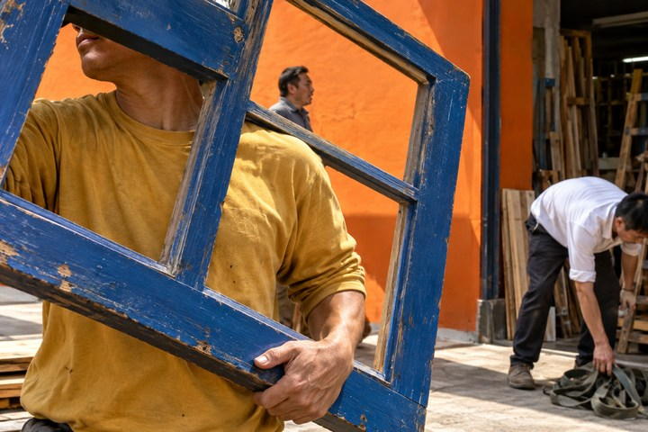
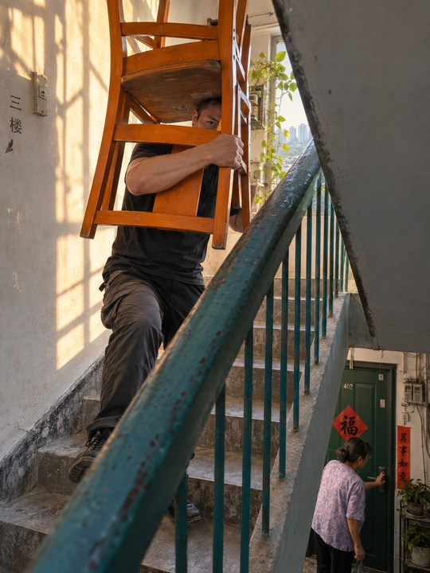
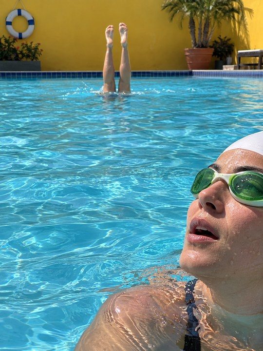
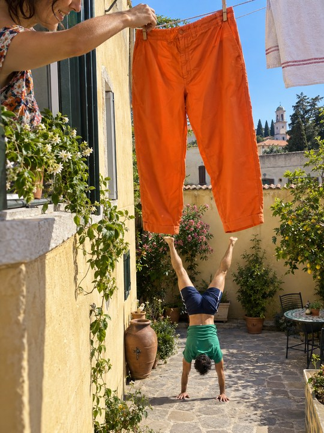
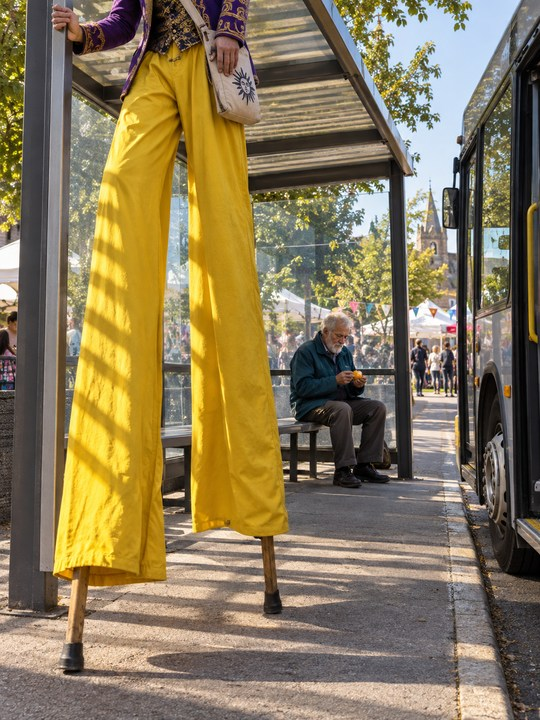
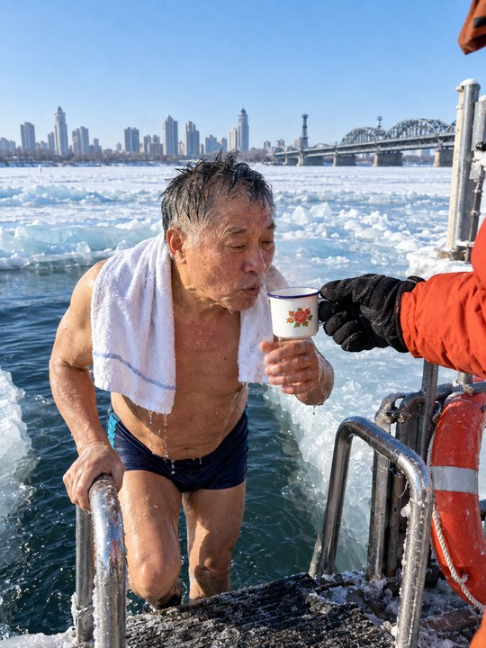

# Photography Skill

**当ai学会怎么看 和 怎么拍**

从一句提示词，或一张已有照片，创作有设计感、临场感与人物温度的摄影作品。

关注机位、距离、动作、光线与色彩：让相机进入现场，让身体和物件组织画面，让日常中的惊喜自然出现。默认追求鲜明、清晰、锐利、通透的成像。

<table>
  <tr>
    <td width="33%" valign="top"><a href="references/approved-23/P03-01-window-frame.png"></a><br><strong>P03 · 搬蓝窗框</strong><br>几何显露</td>
    <td width="33%" valign="top"><a href="references/approved-23/P08-01-staircase-chairs.png"></a><br><strong>P08 · 搬椅上楼</strong><br>几何显露</td>
    <td width="33%" valign="top"><a href="references/approved-23/P09-02-pool-surface.png"></a><br><strong>P09 · 泳池出水</strong><br>方向与尺度</td>
  </tr>
  <tr>
    <td width="33%" valign="top"><a href="references/approved-23/P10-02-feet-waiting-for-trousers.png"></a><br><strong>P10 · 空裤腿与倒立</strong><br>视觉巧合</td>
    <td width="33%" valign="top"><a href="references/approved-23/P13-06-giant-at-bus-stop.png"></a><br><strong>P13 · 高跷等公交</strong><br>日常反差</td>
    <td width="33%" valign="top"><a href="references/approved-23/P23-25-harbin-winter-swim-24mm.png"></a><br><strong>P23 · 哈尔滨冬泳</strong><br>温度与关照</td>
  </tr>
</table>

[查看全部 23 张作品](GALLERY.md) · [阅读统一分析](references/approved-23-analysis.md) · [查看技能正文](SKILL.md)

## 可以怎样使用

| 输入 | 工作方式 |
|---|---|
| 一句话、题材或场景 | 确定值得观看的具体内容，选择机位、人物状态与空间关系，再生成新作品。 |
| 已有摄影作品 | 先观察原图与保留项，在允许范围内重组构图、光线、色彩与环境关系。 |
| 只想分析或写提示词 | 按指定范围输出构图分析或可执行提示词。 |

## 核心方法

- **相机身处事件中。** 桌边、水线、门内、工作物旁，机位与距离决定参与感。广角创作从全画幅等效 24–28mm 起步。
- **近处形状参与观看。** 手臂、窗框、托盘、衣物和反射可以引导、遮挡、分区，与人物活动发生具体联系。
- **复杂场景有阅读顺序。** 通过轮廓间隙、大小、光区与色块组织空间，让重要环境保持可读。
- **生活状态同样有力量。** 安静的神态、直接的视觉巧合、人物之间的小动作都可以成为照片的看点。
- **质感鲜明通透。** 自然肤色、清洁暗部、明亮中间调、受控高光和真实材质，共同建立空间与颜色。

三种创作路径可以交叉使用：**生活现场的张力、视觉巧合与陌生化、人物互动与动作交会**。系列创作改变观看关系与现场内容，避免只替换地点、时代和人物职业。

画幅服从题材和用户要求；竖幅可从 3:4 起步。每张照片不必都有笑话、藏脸、三层人物或“第二眼谜底”。历史、科幻等题材只在被要求时展开，摄影始终是总纲。

## 安装与调用

下载仓库，或克隆到本地：

```sh
git clone https://github.com/dacnay816y62-hub/Photography-Skill.git photography-skill
```

将 `photography-skill` 文件夹放入所用工具的技能目录，并保留 `SKILL.md`、`agents/` 和 `references/` 的相对结构。在 Codex 中，可使用配置的 `$CODEX_HOME/skills/` 目录；未配置时使用 `~/.codex/skills/`。重新加载技能后调用：

```text
$photography-skill
福建海岛乡村，午后，竖构图。
希望机位贴近生活现场，人物之间有小小的惊喜，色彩清晰通透。
```

已有照片再创作时，附上照片并说明保留项：

```text
$photography-skill
以这张照片为基础，保留人物身份、服装和地点线索。
重新组织近处形状与远处环境，让人物状态更具体，构图更有张力。
保持自然肤色与鲜明通透的质感。
```

技能提供摄影判断与提示词方法，实际生成需当前环境具备图像生成或编辑工具。没有图像工具时，可输出分析与完整提示词。

## 仓库内容

| 文件 | 用途 |
|---|---|
| [SKILL.md](SKILL.md) | 入口、判断标准、工作流程与交付方式 |
| [核心方法](references/core-photography.md) | 23 张样例的共同摄影逻辑与三种创作路径 |
| [统一分析](references/approved-23-analysis.md) | 共同规律与每张作品的观察、转译方法 |
| [人物构图](references/human-composition.md) | 惊喜、戏剧感、乱中秩序与换题材时的保留项 |
| [广角空间](references/wide-angle-space.md) | 24–28mm 的机位、距离、尺度与环境关系 |
| [成像标准](references/rendering-dna.md) | 鲜明色彩、锐利细节、通透曝光与材质 |
| [生成流程](references/generation-recipes.md) | 提示词创作与已有照片再创作 |
| [成片审阅](references/quality-review.md) | 结果检查与定向修正 |
| [样例原图](references/approved-visual-examples.md) | P01–P23 原图、机制索引与文件清单 |

## 研究与样例说明

构图研究起于亚历克斯·韦伯《错位》，成像原则参考 [Fantasy 摄影模拟](https://github.com/dacnay816y62-hub/fantasy-photography-simulation-github)，并通过多轮生成、筛选与反馈整理为当前方法。研究记录见 [素材说明](references/source-notes.md) 与 [文字观察索引](references/source-atlas.md)。

仓库中的 23 张样例均为 AI 生成作品，不是画册摄影原作；原始画册扫描页不在本仓库内。样例题名描述创作设定，焦距描述用于指导视角，不是实拍设备或 EXIF 认证。
